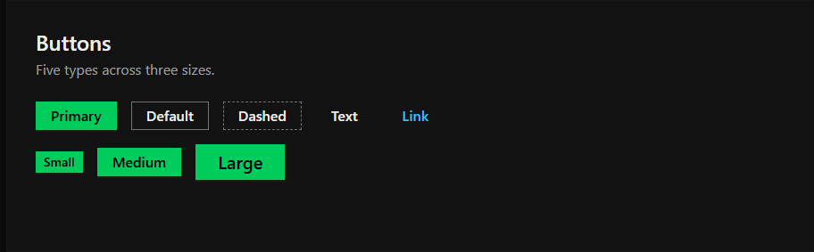
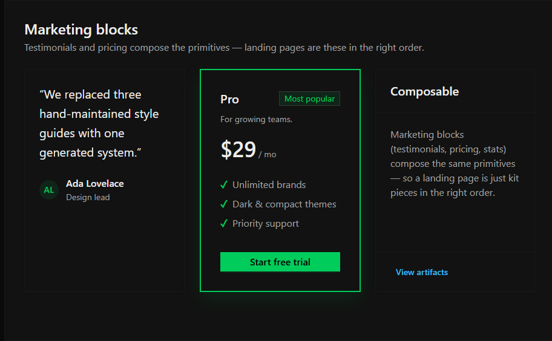
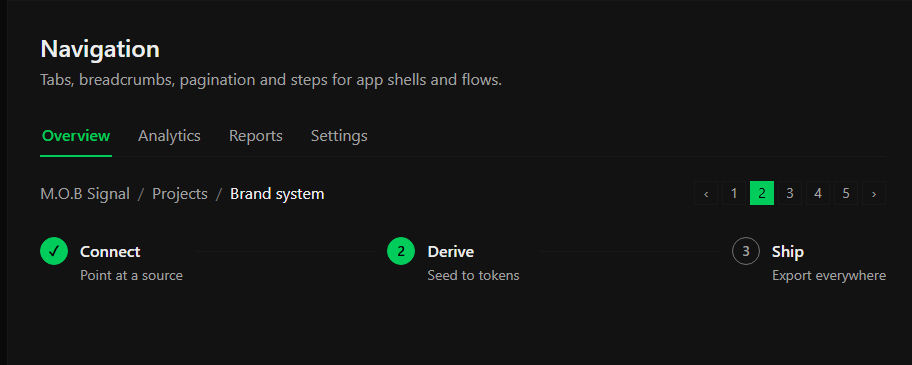

<div align="center">


# M.O.B Signal

[](https://nodejs.org)
[](https://react.dev)
[](package.json)
[](LICENSE)

<p>A dark, square design system for engineering consoles and data-dense interfaces.</p>

</div>

M.O.B Signal is a framework-neutral web design system for products that need clear hierarchy,
operational states, and dense information display. It provides design tokens, shared component
styles, overlays, local fonts, brand assets, and optional browser utilities.

## Design Showcase

| Buttons & Actions | Form Controls |
| :---: | :---: |
|  |  |
| **Cards & Pricing** | **Navigation & Tabs** |
|  |  |
| **Data Display & Tables** | **Color Palette** |
|  |  |

## Features

- Design tokens for color, typography, spacing, shape, layout, and semantic states.
- Shared CSS styles for buttons, inputs, controls, cards, tables, navigation, and feedback.
- Overlay styles for dialogs, tooltips, popovers, and other layered UI.
- Tailwind CSS v4 theme export with semantic colors, font families, and the 4px spacing scale.
- Three bundled variable fonts covering Latin and Vietnamese text.
- Logo, icon, and other brand assets for product interfaces.
- Framework-neutral tab utility with WAI-ARIA keyboard navigation.

## Installation

Install M.O.B Signal as a design-system skill:

```bash
npx skills add dexter826/mob-design-system
```

Or target the specific skill explicitly:
```bash
npx skills add dexter826/mob-design-system --skill mob-signal
```

This installs the isolated skill definition and self-contained reference payload (tokens and 28 zero-radius UI components) for supported AI coding tools without downloading repository build or test artifacts.

## Usage

### CSS

Import the foundation styles first, followed by component and overlay styles:

```css
@import "mob-signal";
@import "mob-signal/components.css";
@import "mob-signal/overlays.css";
```

The foundation provides design tokens and typography. Component styles provide shared recipes for
controls, navigation, cards, tables, and other interface patterns. Overlay styles provide dialogs,
tooltips, popovers, and related layered UI.

### Tailwind CSS v4

Import the M.O.B Signal theme after Tailwind:

```css
@import "tailwindcss";
@import "mob-signal/tailwind.css";
```

This exports semantic colors, font families, the 4px spacing scale, and the system's zero-radius
rule through Tailwind utilities.

### Tabs

The optional tab utility provides keyboard navigation and ARIA state management for tablists:

```html
<script src="mob-signal/assets/components.js" defer></script>
```

```html
<div role="tablist" aria-label="Sections">
  <button id="overview-tab" role="tab" aria-controls="overview-panel" aria-selected="true">
    Overview
  </button>
</div>

<section id="overview-panel" role="tabpanel" aria-labelledby="overview-tab">
  ...
</section>
```

### API

#### `MobSignal.initTabs(root)`

Initializes tablist elements within the document or a given container.

**Parameters:**

- `root` (`Document | HTMLElement`, optional): Target container. Defaults to `document`.

The utility links tabs and panels through `aria-controls` and `aria-labelledby`, manages
`aria-selected` state, and supports arrow, Home, and End keyboard navigation.

## Design tokens

Use semantic token names rather than hardcoded values. M.O.B Signal includes tokens for:

- Color and semantic states
- Typography and local font families
- Spacing and layout
- Square geometry and borders
- Elevation, overlays, and motion
- Focus, interaction, and accessibility states

The system is dark-only and uses a 4px spacing scale with square geometry.

## Accessibility

Use visible focus states, semantic HTML, keyboard-operable controls, and non-color indicators for
status and selection. Apply the documented semantic roles and contrast requirements when composing
new interface patterns.

## Reference

| Path | Purpose |
| :--- | :--- |
| [`BRAND.md`](BRAND.md) | Visual language, token roles, component behavior, accessibility, and asset usage |
| [`skills/mob-signal/`](skills/mob-signal/SKILL.md) | Agent skill definition and standalone reference payload |
| [`tokens.measured.json`](tokens.measured.json) | Token source values and measurements |
| [`dist/colors_and_type.css`](dist/colors_and_type.css) | Foundation design-token custom properties |
| [`dist/components.css`](dist/components.css) | Shared component styles |
| [`dist/overlays.css`](dist/overlays.css) | Dialog, tooltip, and popover styles |
| [`dist/tailwind.css`](dist/tailwind.css) | Tailwind CSS v4 design tokens |
| [`registry/`](registry/) | shadcn/ui React components (Button, Input, Table, Badge, Dialog, Tabs) |
| [`showcase/`](showcase/) | Design system showcase hub and preview pages |
| `assets/components.js` | Framework-neutral tab navigation utility |
| [`fonts/`](fonts/) | Bundled fonts, manifest, and licenses |
| [`logos/`](logos/) | Vector and raster brand assets |
