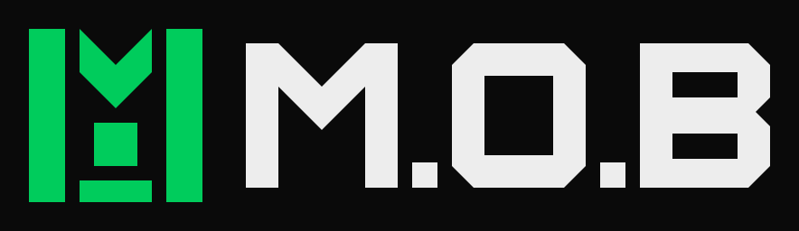
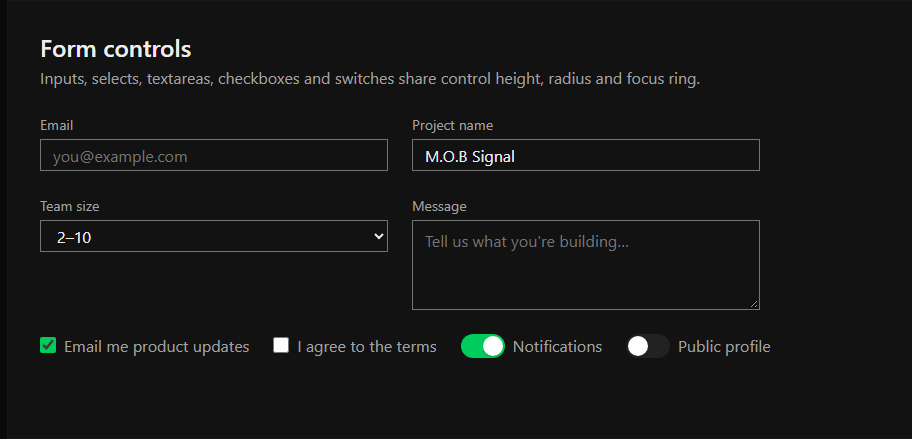
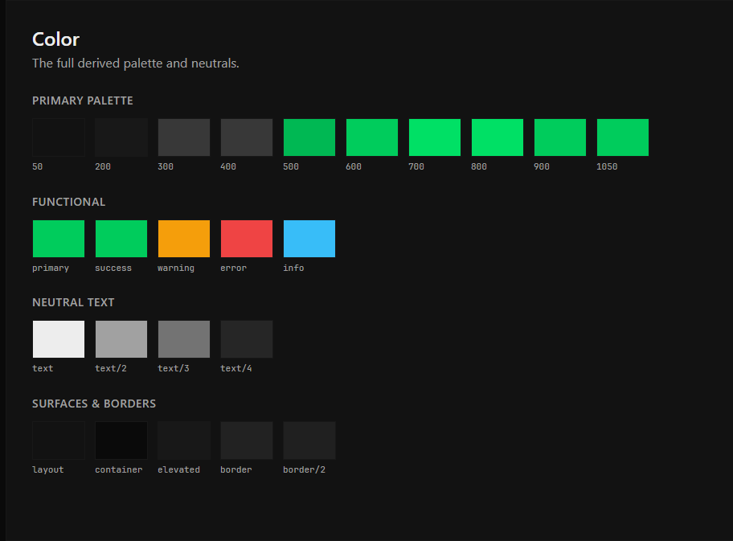

<div align="center">



# M.O.B Signal

[](https://nodejs.org)
[](https://react.dev)
[](package.json)
[](LICENSE)

<p>Dark-mode web design system with shared CSS tokens, UI component styles, and local variable fonts with Vietnamese glyph coverage.</p>

</div>

## Design Showcase

| Buttons & Actions | Form Controls |
| :---: | :---: |
|  |  |
| **Cards & Pricing** | **Color Palette** |
|  |  |

## Features

- JSON tokens that compile to CSS variables for color, typography, shape, and spacing.
- Component stylesheets for buttons, inputs, controls, cards, and modal dialogs.
- Three bundled variable fonts (Space Grotesk, Plus Jakarta Sans, JetBrains Mono) covering Latin and Vietnamese.
- Standalone tab script with WAI-ARIA keyboard navigation.
- Local test suite for token consistency, WCAG contrast ratios, and browser regressions.
- React service console running against local sample data.

## Installation

Prerequisites: Node.js 24 LTS and npm.

```bash
git clone <repository-url>
cd mob-design-system
npm ci
npm run build
npm start
```

Install as an AI agent skill:

```bash
npx skills add dexter826/mob-design-system
```

The local development server serves previews at `http://127.0.0.1:4173/`.

## Usage

Load the stylesheets in this order:

```html
<link rel="stylesheet" href="colors_and_type.css">
<link rel="stylesheet" href="components.css">
<link rel="stylesheet" href="overlays.css">
<script src="assets/components.js" defer></script>
```

Edit tokens in `tokens.measured.json`, then run `npm run build` to update the CSS variables, compatibility tokens, and logo assets.

## API

### `MobSignal.initTabs(root)`

Initializes tablist elements within the document or a given DOM node.

**Parameters:**
- `root` (`Document | HTMLElement`, optional): Target container. Defaults to `document`.

**Behavior:**
Binds keyboard navigation (`ArrowLeft`, `ArrowRight`, `Home`, `End`) to elements with `role="tab"`, links panels via `aria-controls`, and handles `aria-selected` attributes.

## Verification

```bash
npm run check:tokens   # Validate canonical tokens and local asset paths
npm run contrast       # Verify WCAG AA and AAA color luminance ratios
npm test               # Run native Node.js unit and regression tests
npm run test:browser   # Run Playwright browser integration checks
```

## Reference

| Path | Purpose |
| :--- | :--- |
| `tokens.measured.json` | Token source values and measurements |
| `colors_and_type.css` | Generated token custom properties |
| `components.css` | Shared component styles |
| `overlays.css` | Modal dialog, tooltip, and popover styles |
| `assets/components.js` | Framework-neutral tab navigation script |
| `fonts/` | Local variable fonts, manifest, and licenses |
| `logos/` | Vector SVG sources and raster PNG exports |
| `ui_kits/app/` | React service console demo |
